# SimulationLab

> Python Jupyter notebooks, mathematical formulations, numerical solvers, and visualizations for Simulation & Modeling laboratory experiments.

[](https://github.com/ritikthakur22/SimulationLab/actions/workflows/simulation-tests.yml)
[](LICENSE)


---

## Table of Contents

- [Overview](#overview)
- [Curriculum & Lab Modules](#curriculum--lab-modules)
  - [Lab 1: Simulation of Chemical Reactions](#lab-1-simulation-of-chemical-reactions)
  - [Lab 2: Pseudo-Random Number Generation & Uniformity](#lab-2-pseudo-random-number-generation--uniformity)
  - [Lab 3: Monte Carlo Pi ($\pi$) Estimation](#lab-3-monte-carlo-pi-pi-estimation)
  - [Lab 4: Markov Decision Processes & Q-Learning](#lab-4-markov-decision-processes--q-learning)
- [Simulation Architecture](#simulation-architecture)
- [Repository Structure](#repository-structure)
- [Installation & Quickstart](#installation--quickstart)
- [Running Automated Tests](#running-automated-tests)
- [License](#license)

---

## Overview

This repository contains the complete laboratory curriculum for **Simulation and Modeling** (Computer Engineering, IOE / Tribhuvan University). It covers four fundamental paradigms of system simulation:

1. **Continuous Deterministic Simulation:** Euler's method for Ordinary Differential Equations (ODEs) modeling chemical kinetics, industrial synthesis, stellar fusion, and clinical pharmacokinetics.
2. **Pseudo-Random Number Generation:** Linear Congruential Generators (LCG) with statistical goodness-of-fit verification via Chi-Square ($\chi^2$) distribution.
3. **Stochastic Monte Carlo Simulation:** Geometric probability and the Law of Large Numbers for approximating mathematical constants ($\pi$).
4. **Discrete State & Reinforcement Learning Simulation:** Markov Decision Processes (MDPs) and model-free Q-Learning for path optimization in a grid world.

---

## Curriculum & Lab Modules

### Lab 1: Simulation of Chemical Reactions

Focuses on modeling the rate of change of continuous systems over time using differential equations and Euler's numerical integration:

$$\frac{dC}{dt} = f(C, t) \implies C_{t + \Delta t} \approx C_t + f(C_t, t) \cdot \Delta t$$

The notebook simulates four distinct kinetic models:
* **Reaction 1 (Equilibrium Reaction):** Reversible reaction $A + B \rightleftharpoons 2C$ with forward rate $k_1 = 0.03$ and reverse rate $k_2 = 0.01$. Outputs concentrations to [Lab_1/output.txt](Lab_1/output.txt).
* **Reaction 2 (Industrial Haber-Bosch Ammonia Synthesis):** Non-linear gas-phase catalytic reaction $N_2 + 3H_2 \rightleftharpoons 2NH_3$ with stoichiometric mass action tracking and equilibrium stabilization. Outputs timestamped reactor logs to [Lab_1/industrial_reactor_log.txt](Lab_1/industrial_reactor_log.txt).
* **Reaction 3 (Stellar Nuclear Fusion):** Proton-proton fusion chain $4\,{}^1\text{H} \to {}^4\text{He} + 2e^+ + 2\nu$ simulating hydrogen fuel depletion versus helium ash buildup in a stellar core.
* **Reaction 4 (Two-Compartment Clinical Pharmacokinetics):** Oral single-dose drug absorption, distribution between bloodstream and peripheral tissues, elimination via hepatic/renal pathways, and evaluation against the minimum effective concentration (MEC) and toxic threshold.

### Lab 2: Pseudo-Random Number Generation & Uniformity

Implements a Linear Congruential Generator (LCG) defined by the recurrence relation:

$$r_{i+1} = (a \cdot r_i + b) \pmod p$$

* **Parameters:** Multiplier $a = 29$, increment $b = 37$, modulus $p = 256$, initial seed $r_0 = 17$, yielding a full-period sequence of $N = 256$ integers.
* **Goodness-of-Fit Verification:** The sequence is partitioned into $k = 8$ bins (expected frequency $E_i = 32$). The Chi-Square test statistic is evaluated:
  $$\chi_0^2 = \sum_{i=1}^{k} \frac{(O_i - E_i)^2}{E_i}$$
* **Result:** Demonstrates $\chi_0^2 = 0.0$, strictly below the critical value $\chi_{0.05, 7}^2 = 14.067$, verifying uniform distribution across all bins.

### Lab 3: Monte Carlo Pi ($\pi$) Estimation

Applies the Monte Carlo technique to approximate the irrational constant $\pi$ through geometric probability:

* A square field of dimension $L \times L$ circumscribes a circle of radius $R = L/2$.
* Random coordinates $(x, y) \in [-L/2, L/2]^2$ are generated representing raindrops.
* Points falling within the circular boundary satisfy:
  $$x^2 + y^2 \le \left(\frac{L}{2}\right)^2$$
* The ratio of raindrops inside the circle to total raindrops approaches the ratio of their areas:
  $$\frac{N_{\text{circle}}}{N_{\text{total}}} \approx \frac{\pi R^2}{(2R)^2} = \frac{\pi}{4} \implies \pi \approx 4 \cdot \frac{N_{\text{circle}}}{N_{\text{total}}}$$
* Visual outputs include convergence plots and scatter visualizations ([Lab_3/rain_drops.png](Lab_3/rain_drops.png), [Lab_3/pi_estimate_20_drops.png](Lab_3/pi_estimate_20_drops.png)).

### Lab 4: Markov Decision Processes & Q-Learning

Explores Reinforcement Learning and the Markov Property:

$$P(S_{t+1} \mid S_t, A_t, S_{t-1}, A_{t-1}, \dots, S_0, A_0) = P(S_{t+1} \mid S_t, A_t)$$

* **Environment:** $4 \times 4$ Grid World ($S_0$ to $S_{15}$) with Start State $S_0$, Goal State $S_{15}$, and Obstacles at $S_5$ and $S_{10}$.
* **Reward Structure:** $+10$ for reaching the goal, $-10$ for hitting obstacles, and $-1$ per normal transition step.
* **Bellman Optimality Update:**
  $$Q(s, a) \leftarrow Q(s, a) + \alpha \left[ R + \gamma \max_{a'} Q(s', a') - Q(s, a) \right]$$
* **Hyperparameters:** Learning rate $\alpha = 0.5$, discount factor $\gamma = 0.9$.
* Demonstrates manual episode walkthroughs (Ep 1–3) and automated Q-table policy convergence.

---

## Simulation Architecture

```mermaid
flowchart TD
    subgraph Lab1["Lab 1: Chemical Kinetics"]
        A["ODE / Rate Equations"] --> B["Euler Integration"]
        B --> C["Equilibrium & Concentration Curves"]
    end

    subgraph Lab2["Lab 2: Pseudo-Random Numbers"]
        D["LCG: (a*r + b) mod p"] --> E["256 Pseudo-Random Sequence"]
        E --> F["Chi-Square Goodness-of-Fit"]
    end

    subgraph Lab3["Lab 3: Monte Carlo Pi"]
        G["Random Drops in L x L Square"] --> H["Boundary Check: x² + y² <= (L/2)²"]
        H --> I["Pi Estimation: 4 * (N_in / N_total)"]
    end

    subgraph Lab4["Lab 4: Q-Learning MDP"]
        J["4x4 Grid World Environment"] --> K["Action Selection (U, D, L, R)"]
        K --> L["Bellman Update Equation"]
        L --> M["Optimal Q-Table Policy"]
    end
```



---

## Repository Structure

```text
SimulationLab/
├── .github/
│   └── workflows/
│       └── simulation-tests.yml   # Multi-version CI workflow for tests & notebooks
├── Lab_1/
│   ├── 1.ipynb                    # Canonical Lab 1 notebook (4 reaction kinetics)
│   ├── ACE080BCT055.ipynb         # Reference lab submission notebook
│   ├── industrial_reactor_log.txt # Haber-Bosch reactor output logs
│   └── output.txt                 # Reaction 1 concentration outputs
├── Lab_2/
│   └── lab2.ipynb                 # LCG generation and Chi-Square goodness-of-fit
├── Lab_3/
│   ├── 3.ipynb                    # Monte Carlo raindrop simulation for Pi
│   ├── pi_estimate_20_drops.png   # Sample estimation convergence plot
│   └── rain_drops.png             # Raindrop scatter visualization
├── Lab_4/
│   ├── 4.ipynb                    # Markov Chains & Q-Learning grid world
│   └── lab4guide.jpeg             # Reference guide notes for MDP walkthrough
├── tests/
│   ├── __init__.py
│   └── test_simulations.py        # Automated unit tests for all mathematical models
├── .gitignore                     # Git ignore patterns for Python, Jupyter & caches
├── LICENSE                        # MIT License
├── README.md                      # Comprehensive laboratory documentation
└── requirements.txt               # Dependencies with flexible version bounds
```

---

## Installation & Quickstart

### 1. Clone the repository

```bash
git clone https://github.com/ritikthakur22/SimulationLab.git
cd SimulationLab
```

### 2. Create and activate a virtual environment

Linux/macOS:
```bash
python3 -m venv .venv
source .venv/bin/activate
```

Windows (PowerShell):
```powershell
python -m venv .venv
.venv\Scripts\Activate.ps1
```

### 3. Install dependencies

```bash
python -m pip install --upgrade pip
python -m pip install -r requirements.txt
```

### 4. Launch Jupyter Notebook or JupyterLab

```bash
jupyter notebook
# or
jupyter lab
```

---

## Running Automated Tests

Run the built-in unit test suite (validates all mathematical calculations without requiring a GUI):

```bash
python -m unittest discover -s tests -v
```

To headless-validate the execution of all Jupyter notebooks using `nbconvert`:

```bash
jupyter nbconvert --to notebook --execute Lab_1/1.ipynb --stdout > /dev/null
jupyter nbconvert --to notebook --execute Lab_2/lab2.ipynb --stdout > /dev/null
jupyter nbconvert --to notebook --execute Lab_3/3.ipynb --stdout > /dev/null
jupyter nbconvert --to notebook --execute Lab_4/4.ipynb --stdout > /dev/null
```

---

## License

This project is licensed under the [MIT License](LICENSE).
